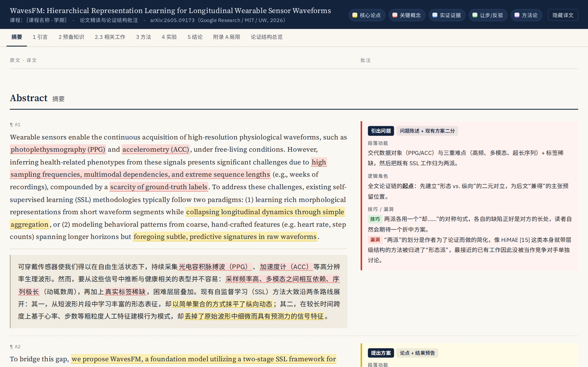
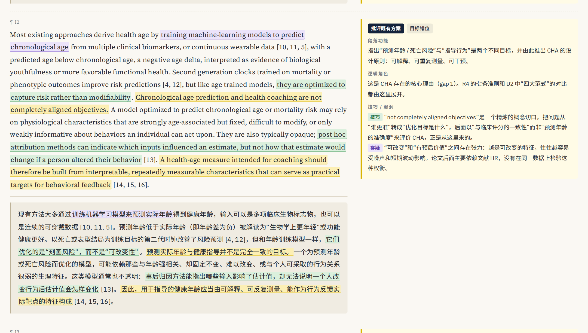
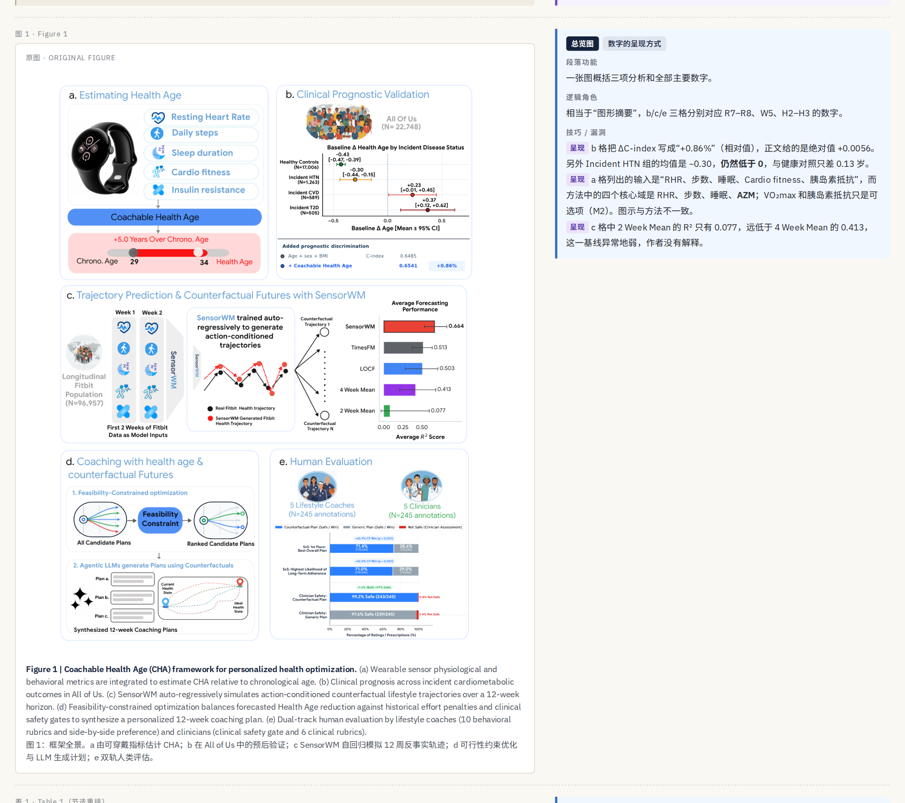
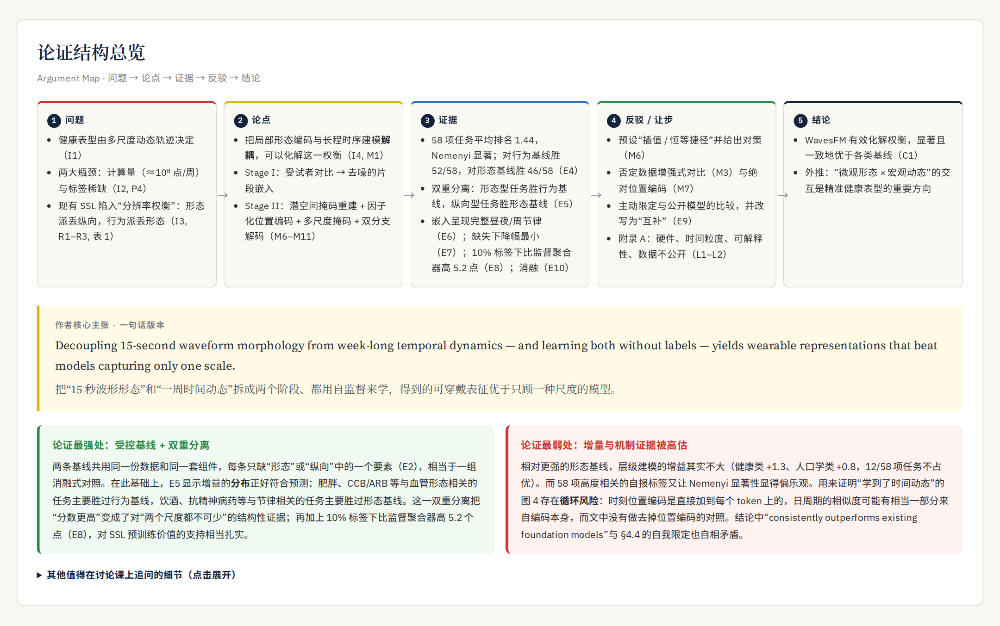
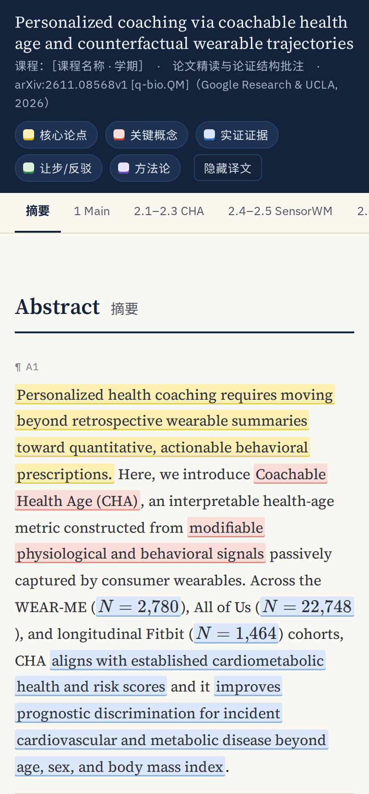

<div align="center">

# paper-annotated-html

**A Claude Code / Agent Skill that turns an academic paper PDF into a single-file, two-column, bilingual (EN ⇄ 中文) annotated HTML for close reading.**

English | [简体中文](README.zh-CN.md)


**Quick install:** `npx skills add dingdinglz/paper-annotated-html`



</div>

Drop a paper PDF into a conversation and ask Claude to "精读 / annotate this paper". The skill produces one
self-contained `.html` file where every paragraph sits next to an analysis card. You can read the paper's
argument one paragraph at a time: what each paragraph says, what it does in the argument, and where the
argument is strong or weak.

It is designed for **course seminars, journal clubs and reading groups**, and for anyone who wants to read
a paper critically instead of just skimming it.

## Features

- **Two-column layout.** On the left, the original English text in full plus a fluent Chinese translation under
  each paragraph. On the right, one Chinese annotation card per paragraph.
- **Five-colour argument highlighting** in *both* languages. Each colour layer can be toggled from the top bar:

  | Colour | Layer | Marks text that… |
  |---|---|---|
  | 🟨 yellow | Thesis | states the claim, a sub-claim, the gap, or a conclusion |
  | 🟥 red | Key concepts | introduces a term the argument depends on |
  | 🟦 blue | Evidence | reports numbers, results, statistical tests |
  | 🟩 green | Concessions / rebuttals | concedes, anticipates objections, limits a claim |
  | 🟪 purple | Methodology | describes design choices, protocols, baselines |

- **Annotation cards.** Each card records the paragraph's *function*, its *logical role* in the
  problem → thesis → evidence → rebuttal → conclusion chain, and *rhetorical moves / weaknesses*. The weaknesses
  include critical-reading flags such as inconsistent numbers, weak baselines and over-claiming.
- **Original figures embedded.** Figures are cropped from the PDF, base64-inlined next to the paragraph that
  discusses them, and open in a lightbox when clicked.
- **Argument map** at the end. It gives a five-stage overview, a one-sentence version of the thesis, and the
  strongest and weakest links in the argument.
- **Single file, responsive.** Sticky section nav, a "hide translation" toggle, KaTeX math, and a single-column
  layout on mobile.

## Screenshots

> The two examples were generated with this skill from *WavesFM* (arXiv:2605.09173) and *Coachable Health Age /
> SensorWM* (arXiv:2611.08568).

**Paragraph row**: highlighted EN + ZH on the left, annotation card on the right.



**Original figures** are embedded next to the discussing paragraph, with critical notes on how the figure presents its numbers.



**Argument map** overview at the end of the document.



<details>
<summary><b>Mobile layout</b></summary>



</details>

## Installation

### One command (recommended)

Install with the [`skills`](https://github.com/vercel-labs/skills) CLI. It works with Claude Code, Codex, Cursor
and other agents that support Agent Skills:

```bash
# Global (user-level) install for Claude Code
npx skills add dingdinglz/paper-annotated-html -g -a claude-code

# Project-level install; the CLI asks which agents to install for
npx skills add dingdinglz/paper-annotated-html
```

Update later with `npx skills update paper-annotated-html`, and remove it with `npx skills remove paper-annotated-html`.

### Manual (git clone)

The repo root *is* the skill, so you can clone it straight into your skills directory:

```bash
# Personal skill (available in every project)
git clone https://github.com/dingdinglz/paper-annotated-html ~/.claude/skills/paper-annotated-html

# Or project-level skill
git clone https://github.com/dingdinglz/paper-annotated-html .claude/skills/paper-annotated-html
```

You can also upload the folder as a custom skill in Claude.ai or the Claude API (Agent Skills).

### Requirements

| Dependency | Used for | Required |
|---|---|---|
| Python 3.8+ (stdlib only) | `pdf_tools.py`, `assemble.py`, `validate.py` | ✅ |
| [poppler-utils](https://poppler.freedesktop.org/) (`pdftotext`, `pdftoppm`, `pdfinfo`) | text extraction, figure cropping | ✅ |
| Chromium / Chrome (or Playwright's headless shell) | optional visual QA screenshots | ❌ |

```bash
sudo apt-get install -y poppler-utils   # Debian / Ubuntu
brew install poppler                    # macOS
```

## Usage

Just ask, in either language:

```text
帮我精读这篇论文，做成双栏批注的 HTML：./paper.pdf
Make an annotated bilingual HTML of this paper for my reading group: ./paper.pdf
```

Claude follows the workflow in [`SKILL.md`](SKILL.md):

1. **Extract**: `pdf_tools.py info / text` pulls the page info and full text.
2. **Plan**: split the paper into paragraph units (A1, I1, M1, E1, C1, L1…) and sketch the argument chain first.
3. **Figures**: `pdf_tools.py captions` suggests crop boxes, `crop` renders them at 200 dpi, and every crop is visually checked.
4. **Write**: one HTML fragment per section (EN + ZH + card), plus an argument-map overview and `meta.json`.
5. **Assemble & validate**: `assemble.py` inlines everything into the template. `validate.py` checks for missing
   Chinese highlights, empty card fields, dead nav links and unfilled placeholders. `screenshot.sh` optionally
   renders desktop and mobile previews.

The result is written next to the PDF as `<name>_annotated.html`.

### Customising

You can override any default in your request, for example fonts, colours, the course name, the target language,
or highlight density. The style variables live at the top of [`assets/template.html`](assets/template.html).
If you don't give a course name, the editable placeholder `［课程名称 · 学期］` is left in the header.

## Repository layout

```text
paper-annotated-html/
├── SKILL.md                     # skill entry point: spec + workflow (read by Claude)
├── assets/template.html         # page template: layout, fonts, highlight colours, JS toggles, lightbox
├── references/
│   ├── annotation-guide.md      # highlight criteria, translation style, card fields, critique checklist
│   └── fragments.md             # exact HTML snippets for rows, equations, figures, tables, overview
├── scripts/
│   ├── pdf_tools.py             # info / text / captions / crop / preview (poppler wrapper)
│   ├── assemble.py              # fragments + figures + meta → single self-contained HTML
│   ├── validate.py              # structural checks on the generated file
│   └── screenshot.sh            # headless desktop + mobile screenshots
└── docs/images/                 # README screenshots
```

## Notes

- Fonts (Source Serif 4, IBM Plex Sans, Noto Sans SC) and KaTeX load from CDNs. Offline viewing falls back to
  system fonts and raw LaTeX.
- Annotations are an aid to critical reading, not a substitute for it. Check important claims against the
  original paper.
- Respect the paper's licence when sharing generated HTML that embeds its text and figures.

## License

[MIT](LICENSE)
