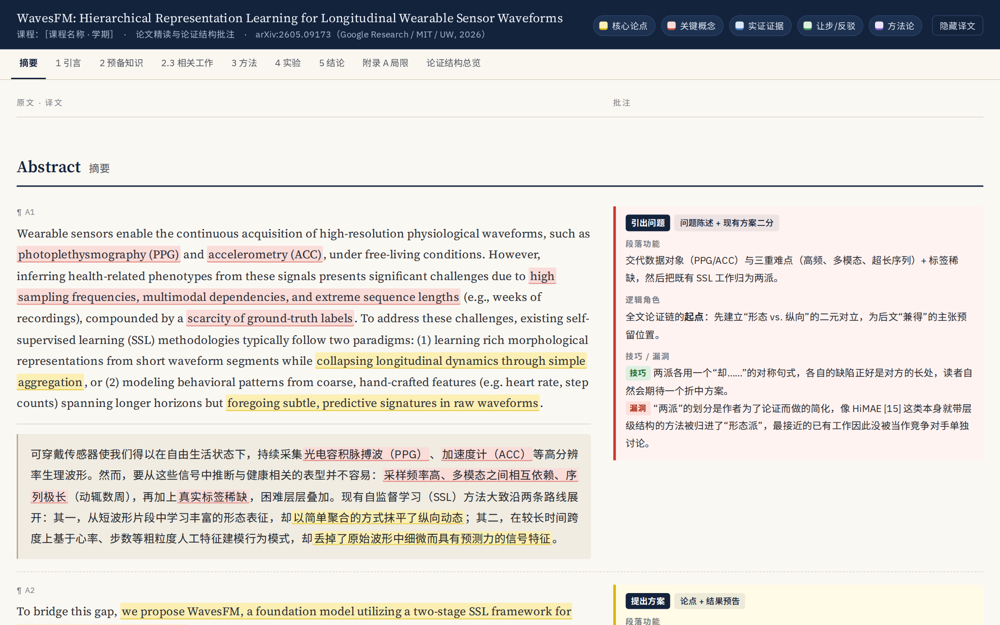
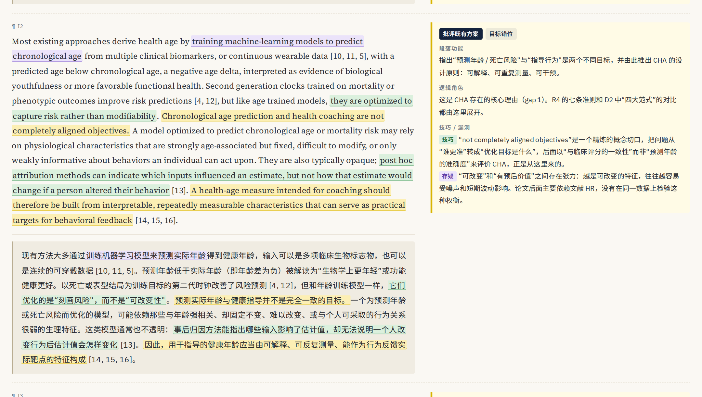
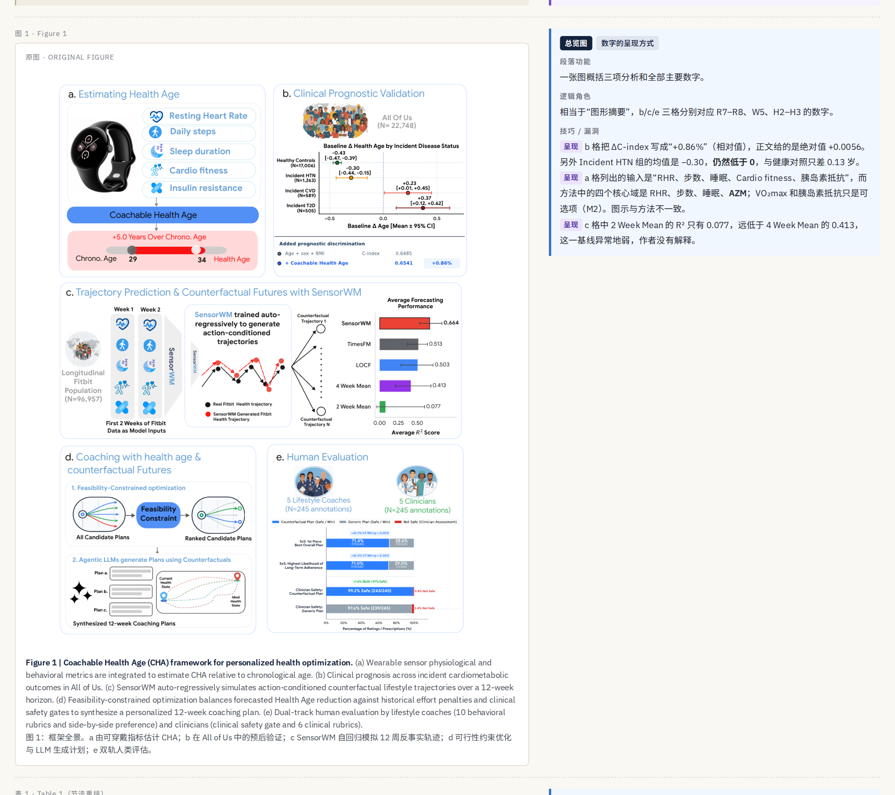
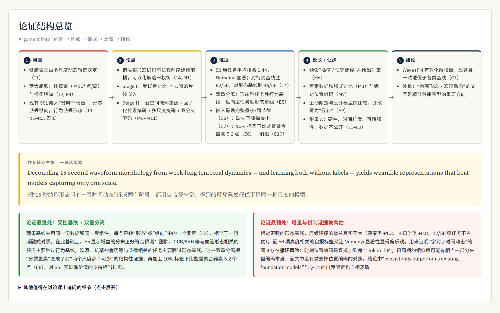
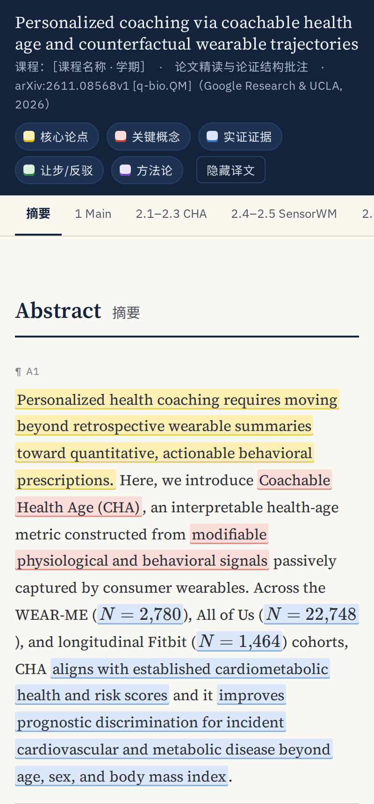

<div align="center">

# paper-annotated-html

**一个 Claude Code / Agent Skill：把学术论文 PDF 变成单文件、双栏、中英对照的论证批注 HTML，用于精读。**

[English](README.md) | 简体中文


**快速安装:** `npx skills add dingdinglz/paper-annotated-html`



</div>

把论文 PDF 丢给 Claude，说一句"帮我精读这篇论文"，它就会生成一个自包含的 `.html` 文件，每一段原文旁边都有一张批注卡片。读者可以逐段看清这段说了什么、在论证里起什么作用、哪里立得住、哪里有漏洞。

适合**课程研讨、Journal Club、读书会**，也适合任何想批判性地读论文、而不只是扫一眼摘要的人。

## 功能特性

- **双栏排版**：左栏是完整的英文原文，每段下面附一段流畅的中文意译；右栏是每段对应的中文批注卡片。
- **五色论证高亮**，中英文都高亮，每一层颜色都能在顶栏单独开关：

  | 颜色 | 维度 | 标注对象 |
  |---|---|---|
  | 🟨 黄 | 核心论点 | 主张、子论点、研究缺口、由证据得出的结论 |
  | 🟥 红 | 关键概念 | 论证所依赖的术语（首次或定义性出现） |
  | 🟦 蓝 | 实证证据 | 数字、实验结果、统计检验、数据规模 |
  | 🟩 绿 | 让步 / 反驳 | 承认局限、预判质疑、否定替代方案 |
  | 🟪 紫 | 方法论 | 设计选择、实验协议、数据划分、基线 |

- **批注卡片**：每张卡片写三项：*段落功能*、在"问题 → 论点 → 证据 → 反驳 → 结论"链条中的*逻辑角色*，以及*技巧 / 漏洞*。漏洞一项会标出数字前后不一致、基线偏弱、结论过度外推等问题。
- **嵌入原图**：从 PDF 中裁出原始图表，以 base64 内联到讨论它的段落旁边，点击可以放大。
- **论证结构总览**：文末给出五阶段论证地图、一句话版本的核心主张，以及论证最强和最弱的环节。
- **单文件 + 响应式**：吸顶章节导航、"隐藏译文"开关、KaTeX 公式，手机上自动切换为单栏。

## 效果截图

> 以下两个示例都由本 skill 生成，原文分别是 *WavesFM*（arXiv:2605.09173）和 *Coachable Health Age / SensorWM*（arXiv:2611.08568）。

**段落行**：左栏是带高亮的英文和中文，右栏是批注卡片。



**原图嵌入**：原图放在讨论它的段落旁边，卡片里点评图中数字的呈现方式。



**论证结构总览**，位于文末。



<details>
<summary><b>移动端效果</b></summary>



</details>

## 安装

### 一行命令安装（推荐）

使用 [`skills`](https://github.com/vercel-labs/skills) CLI 安装，支持 Claude Code、Codex、Cursor 等支持 Agent Skills 的工具：

```bash
# 全局（用户级）安装到 Claude Code
npx skills add dingdinglz/paper-annotated-html -g -a claude-code

# 项目级安装，CLI 会询问要安装到哪些 agent
npx skills add dingdinglz/paper-annotated-html
```

之后可以用 `npx skills update paper-annotated-html` 更新，用 `npx skills remove paper-annotated-html` 卸载。

### 手动安装（git clone）

仓库根目录就是 skill 本身，直接 clone 到 skills 目录即可：

```bash
# 个人级（所有项目可用）
git clone https://github.com/dingdinglz/paper-annotated-html ~/.claude/skills/paper-annotated-html

# 或项目级
git clone https://github.com/dingdinglz/paper-annotated-html .claude/skills/paper-annotated-html
```

也可以把整个文件夹作为自定义 skill 上传到 Claude.ai 或 Claude API（Agent Skills）。

### 依赖

| 依赖 | 用途 | 是否必需 |
|---|---|---|
| Python 3.8+（仅标准库） | `pdf_tools.py`、`assemble.py`、`validate.py` | ✅ |
| [poppler-utils](https://poppler.freedesktop.org/)（`pdftotext`、`pdftoppm`、`pdfinfo`） | 文本提取、图表裁剪 | ✅ |
| Chromium / Chrome（或 Playwright 的 headless shell） | 可选的截图自检 | ❌ |

```bash
sudo apt-get install -y poppler-utils   # Debian / Ubuntu
brew install poppler                    # macOS
```

## 使用

直接说就行，中英文都可以：

```text
帮我精读这篇论文，做成双栏批注的 HTML：./paper.pdf
Make an annotated bilingual HTML of this paper for my reading group: ./paper.pdf
```

Claude 会按 [`SKILL.md`](SKILL.md) 里的流程执行：

1. **提取**：用 `pdf_tools.py info / text` 获取页面信息和全文。
2. **规划**：把论文切成段落单元（A1、I1、M1、E1、C1、L1……），先画出论证链条。
3. **图表**：`pdf_tools.py captions` 给出建议的裁剪框，`crop` 以 200 dpi 裁图，每张图都要人工过目。
4. **撰写**：每个章节写一个 HTML 片段（英文 + 中文 + 卡片），另外写总览和 `meta.json`。
5. **组装与校验**：`assemble.py` 把所有内容内联进模板。`validate.py` 检查中文是否缺高亮、卡片字段是否为空、导航是否有死链、占位符是否未填。`screenshot.sh` 可选，用来生成桌面端和移动端截图。

输出文件放在 PDF 同目录，命名为 `<name>_annotated.html`。

### 自定义

字体、配色、课程名称、目标语言、高亮密度等，都可以在请求里直接说明，覆盖默认设置。样式变量在 [`assets/template.html`](assets/template.html) 顶部。没有提供课程名称时，页眉会保留可编辑的占位符 `［课程名称 · 学期］`。

## 目录结构

```text
paper-annotated-html/
├── SKILL.md                     # skill 入口：规格说明 + 工作流（Claude 读取）
├── assets/template.html         # 页面模板：布局、字体、高亮配色、开关脚本、灯箱
├── references/
│   ├── annotation-guide.md      # 高亮标准、翻译风格、卡片字段、批判性阅读清单
│   └── fragments.md             # 段落行、公式、图表、表格、总览的 HTML 片段
├── scripts/
│   ├── pdf_tools.py             # info / text / captions / crop / preview（poppler 封装）
│   ├── assemble.py              # 片段 + 图片 + meta → 单文件 HTML
│   ├── validate.py              # 生成结果的结构校验
│   └── screenshot.sh            # 无头浏览器桌面端 + 移动端截图
└── docs/images/                 # README 截图
```

## 说明

- 字体（Source Serif 4、IBM Plex Sans、Noto Sans SC）和 KaTeX 从 CDN 加载。离线查看时会回退到系统字体，公式显示为原始 LaTeX。
- 批注是批判性阅读的辅助，不能代替阅读本身。重要结论请对照原文核实。
- 生成的 HTML 包含论文原文和原图，分享前请注意论文本身的许可协议。

## 许可证

[MIT](LICENSE)
